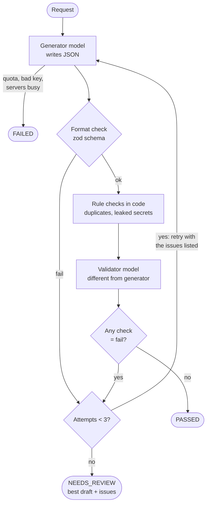

# AI pipeline & providers

_Last updated: 2026-11-06_

This explains how the backend's AI module (`backend/ai/`) works, how to set up **OpenRouter** (the main provider since 2026-11-06, D-025) or Gemini, how to try it from the terminal, and how to move to a paid tier or another provider later.

## 1. How a generation works

Every AI step (technique suggestion, scenario draft, test-case generation) goes through the same pipeline in [backend/ai/orchestrator.js](../backend/ai/orchestrator.js):



**The four checks** (shown to the tester in step 3):

| Check | Who checks | Fails when… |
|---|---|---|
| `format` | Code (zod schemas in `schemas.js` + `checks/structure.js`) | JSON is missing fields or has wrong types, a technique wasn't requested, or a test case points at an unknown scenario or a scenario has no cases |
| `requirementCoverage` | AI validator | A rule, limit or condition in the requirement isn't covered |
| `techniqueCompliance` | AI validator | A technique is applied wrongly (e.g. boundary value without just-below/on/just-above values) |
| `rules` | Code **and** AI validator | Exact duplicates, real-looking secrets (API keys, tokens, private keys), unsafe or contradictory content. Near-duplicates, real-looking emails, card numbers and Thai IDs only **warn** |

A check can be `pass`, `warn` (usable, shown to the tester) or `fail` (triggers a retry).

**Results** (saved as a `GenerationRun` row in later slices):

| Status | Meaning | What the tester gets |
|---|---|---|
| `PASSED` | An attempt passed every check | The output |
| `NEEDS_REVIEW` | 3 attempts, none passed; or the validator itself was unavailable | The best draft plus all issues, to fix by hand |
| `FAILED` | No usable output: quota reached, servers busy, bad API key or model name, an invalid request, or 3 unreadable answers | An error message |

The **3 attempts are for quality problems only**. Problems with the AI service itself are handled separately (next section), so they don't use up those attempts. Each generation makes up to **6 AI calls** (3 attempts × generator + validator), plus any automatic retries for busy servers. Technique suggestion is a single cheap call with no AI validator.

### Test cases: small batches, two at a time (D-030)

A test-case answer is the longest the AI writes, so "Generate test cases" doesn't send all scenarios in one request:

- Only scenarios **without** test cases are sent (scenarios with test cases are locked, D-029).
- They are split into batches of at most **8 estimated test cases** (`MAX_CASES_PER_BATCH` in `services/test-case-rows.js`), usually 2–3 scenarios. Each batch is one full pipeline run (generator + validator, up to 3 attempts) and is saved as its own `GenerationRun`.
- **Two batches run at the same time** (`PARALLEL_BATCHES`). Results are saved in scenario order, so TC numbers follow the scenarios.
- A failed batch stops the generation after its pair. Batches that passed keep their test cases; the remaining scenarios can simply be generated again.

**Why these numbers** (free models, 120 s limit per request):

| Test | Result |
|---|---|
| 4 English scenarios (13 cases) in one request, OpenRouter | PASSED in 84 s |
| 8 Thai scenarios (26 cases) in one request, OpenRouter | Both models ran past 120 s → FAILED |
| Same 8 Thai scenarios, batches of 4 scenarios, one after another | Batch 1 passed (generator 101 s); batch 2's retry timed out → 13 of 26 cases |
| Same, batches of at most 8 estimated cases, one after another | **PASSED, all 26 cases**, every batch first try, 541 s in total |
| English requirement, 18 cases in 3 batches, two at a time, **Gemini** | PASSED in about 31 s (Thai: about 34 s) |

Thai answers need more tokens and time than English ones, so Thai reaches the time limit first.

### One test-data plan for all batches (D-035)

Batches can't see each other, so each one used to make up its own test data (in Test 8 of the AI Test Log, batches used different school codes, and one case deleted a school other cases still needed). Now one short call comes first:

- `planTestData` (kind `TEST_DATA_PLAN`) writes **conventions** (naming and formats) and **shared records** (`exists` = set up before testing; `doesNotExist` = a value for "not found" checks). Generator only, no AI validator; format check (unique record ids) + sensitive-data check. **At most 2 tries** (each batch still has its own 3). About 10–30 s per try.
- Every batch gets the same plan and two rules: shared records are **read-only**; a case that adds, edits or deletes data sets up its **own** record in its precondition, named with its scenario number and position (e.g. `SCH-T3-2`), so names never clash across batches.
- The validator gets the plan too; breaking it is a **warning**, never a fail, so it costs no retry.
- The plan is saved on the requirement (`Requirement.testDataPlan`). Later clicks send it back and **only add** records (the code keeps existing ones even if the AI changes them). When no test cases are left, it's cleared.
- Only a PASSED plan is used. If planning fails (busy, quota, a failed check), the batches run without a plan, as before.

### When the AI service has problems

| Problem (HTTP code) | What happens |
|---|---|
| Servers busy / "high demand" (500–504), or the connection drops | **Wait and retry** the same model up to 2 more times (3 s, then 8 s). Still busy → try the **fallback model** (`gemini-3.7-flash` for the generator, `gemini-3.1-flash-lite` for the validator). Busy too → `FAILED`: "Gemini is busy… try again in a few minutes" |
| Too slow: no answer within **120 s** (`AI_REQUEST_TIMEOUT_SECONDS`) | The request is cancelled and the **fallback model** is tried straight away. A model that hung once usually hangs again (we measured a 17-minute hang), so it isn't retried |
| Quota / rate limit (429) | Stop at once → `FAILED`. Waiting a few seconds doesn't help |
| Bad API key (400/401/403), model not available (404) | Stop at once → `FAILED`, with Google's explanation (e.g. "no longer available to new users") |
| Invalid request (400) | Stop at once → `FAILED`. Sending the same request again can't work |
| **Empty answer** (200 with no text; seen from overloaded OpenRouter hosts) | Treated like "busy" (D-031): wait and retry, then the fallback model |
| Answer isn't valid JSON | Counts as a failed **format** check, so it's retried |
| Validator unavailable | The draft is kept but marked `NEEDS_REVIEW`. It's never auto-approved unchecked |

The results record which model **actually** answered (e.g. the fallback), in `generatorModel` / `validatorModel`.

### Walkthrough: what happens for one request

Taking `try-ai.js cases "Users must reset their password…"` as the example:

1. **`scripts/try-ai.js`** reads the command and the text, then calls `draftScenarios()`. It only starts things and prints results.
2. **`ai/index.js`** is the front door. It asks `providers/index.js` which AI to use, then gives the job to the orchestrator labelled `kind: "SCENARIOS"`.
3. **`ai/providers/index.js`** reads `.env`. With `GEMINI_API_KEY` set, the generator is `gemini-3.5-flash` and the validator is `gemini-3.5-flash-lite`, each with a fallback model and a 120 s time limit per request.
4. **`ai/orchestrator.js`** looks up the recipe for `SCENARIOS`: the answer shape from `schemas.js` and the prompt from `prompts/draftScenarios.js`. Then it runs the attempt loop:
   1. **Build the prompt** (`prompts/draftScenarios.js` + `prompts/shared.js`): the rules, the technique guidance from `techniques.js`, the requirement inside `<requirement>` tags, and on retries the previous attempt's issues.
   2. **Call the generator** (`providers/gemini.provider.js`): the request asks Gemini to answer in JSON with exactly the given shape. Busy-server handling happens here, and SDK errors are translated into the types in `errors.js`.
   3. **Format check**: `schemas.js` (zod) checks every field and type, then `checks/structure.js` checks against the input (only the requested techniques; every test case points at a real scenario).
   4. **Code checks**: `checks/duplicates.js` and `checks/sensitiveData.js`.
   5. **Call the validator** with `prompts/validate.js`. It returns 3 verdicts, which are checked with zod too.
   6. **Decide** (`checks/result.js`): combine into the 4 checks. No `fail` → done; otherwise loop with the issues.
5. The orchestrator returns one object with the same fields as the `GenerationRun` table: status, attempts, output, checks per attempt, token usage, models.
6. For `cases`, `try-ai.js` labels the scenarios `S1, S2…` and runs the same loop with `kind: "TEST_CASES"`.

**Why it's built this way**
- **JSON schema *and* zod:** the schema makes the model *likely* to answer in the right shape, and zod *proves* it did. Some schema rules are also left out of what's sent to the provider (list-size limits that Gemini rejects), but zod still enforces them.
- **Code checks before the AI validator:** they're free, instant and certain. An AI can miss a leaked key; a regular expression can't.
- **A different validator model:** a model reviewing its own output tends to agree with itself.
- **pass / warn / fail:** only `fail` forces a redo. Warnings are shown to the tester without blocking.
- **Error types:** some problems can't be fixed by retrying (quota, bad key), others can (bad JSON, weak output).

**Safety measures built into the prompts** (`backend/ai/prompts/`):
- The requirement is wrapped in `<requirement>` tags, and the model is told to treat it as data, never as instructions. This guards against "prompt injection" hidden in an uploaded document.
- Answers are written in the requirement's language (Thai in → Thai out).
- Only fake test data is allowed (`@example.com`, published test card numbers).

### Changing a prompt: rules of thumb

Prompts are tuned from real runs (AI Test Log), which risks rules that clash or only fit the documents we test with. Before adding a rule:
- **Prefer a general rule** ("don't invent rules the requirement doesn't state") over a fix for one document.
- **Examples never come from test documents** (the school use case): models copy examples word for word (Test 9: the plan copied "SCH- + 3 digits"). A unit test checks this.
- **Keep the rule count steady**: merge the new rule into an existing line or replace one. Count rules before and after.
- **Read the whole prompt for clashes** (two real failures were contradictions: "concrete data" for scenarios vs test cases; "each line" vs "join wrapped lines").
- **Prefer code** for anything code can check (structure, ids, merging), and **warn instead of fail** in the validator unless the problem would mislead a tester, so a rule never costs retries for little gain.

## 2. Files

| File | Role |
|---|---|
| `ai/index.js` | Public API: `suggestTechniques`, `draftScenarios`, `planTestData`, `generateTestCases`, `readRequirementImage`. The rest of the backend imports only this |
| `ai/test-data-plan.js` | Keeps the test-data plan add-only (`mergeTestDataPlans`) and picks the plan the batches get (`nextTestDataPlan`) |
| `ai/orchestrator.js` | The pipeline above |
| `ai/techniques.js` | Technique list and prompt guidance. **Add new techniques here** (plus frontend translations) |
| `ai/schemas.js` | zod schemas for every AI answer. Also sent to the model as a JSON schema |
| `ai/checks/` | Code checks: structure, duplicates, sensitive data |
| `ai/prompts/` | Prompt text for each step and for the validator |
| `ai/providers/` | `openrouter.provider.js` (main), `gemini.provider.js`, `mock.provider.js`; `reliability.js` (time limit, busy retries, fallback model — shared by the real providers); `index.js` picks them from env |
| `ai/errors.js` | `ProviderError`, `ProviderQuotaError`, `ProviderAuthError` |
| `ai/__tests__/` | Tests (`npm test`). They always use the mock, so no key or quota is needed |
| `scripts/try-ai.js` | Terminal tool (section 4) |

## 3. Setting up OpenRouter (main provider)

[OpenRouter](https://openrouter.ai) gives one API key for many models from different companies, free ones (ID ending in `:free`) and paid ones. It uses the OpenAI request format, so the provider uses the `openai` SDK with OpenRouter's address.

1. Create an account at **https://openrouter.ai**, then **Keys → Create key**.
2. In `backend/.env`, add:
   ```
   OPENROUTER_API_KEY=<your key>
   ```
   Never commit this file; `.env` is already in `.gitignore`.
3. That's all. With this key set, OpenRouter is used for both the generator and the validator, even if a Gemini key is also set.

| Variable | Default | Meaning |
|---|---|---|
| `OPENROUTER_API_KEY` | — | Enables OpenRouter (the default provider when set) |
| `OPENROUTER_GENERATOR_MODEL` | `nvidia/nemotron-3-ultra-550b-a55b:free` | Model that writes scenarios and test cases |
| `OPENROUTER_VALIDATOR_MODEL` | `nvidia/nemotron-3.5-super-vl:free` | Model that checks them (a different model from the generator, D-006) |
| `OPENROUTER_GENERATOR_FALLBACK_MODEL` | `recursive/flint-v1.0:free` | Used when the generator model is busy or too slow. `none` disables it |
| `OPENROUTER_VALIDATOR_FALLBACK_MODEL` | `cohere/north-mini-code:free` | Used when the validator model is busy or too slow. `none` disables it |
| `OPENROUTER_APP_URL` / `OPENROUTER_APP_NAME` | — / `AI Test Case Generator` | Optional: how the app appears on openrouter.ai |

**How the defaults were chosen (2026-11-06).** The same Thai scenario-draft prompt (course registration: credit limits + status changes) was sent once to each free model. Every model answered with valid JSON and Thai titles:

| Model | Time | Scenarios | Notes |
|---|---|---|---|
| `nvidia/nemotron-3-ultra-550b-a55b:free` | 90 s | 10 | Largest; specific boundary values → **generator** |
| `nvidia/nemotron-3.5-super-vl:free` | 85 s | 10 | Similar quality (same company as the generator) |
| `dots-studio/dots-3-note-preview:free` | 65 s | 8 | Good; other company and host → **generator fallback** |
| `nvidia/nemotron-3-nano-omni-30b-a3b-reasoning:free` | 88 s | 12 | Many but small model |
| `recursive/flint-v1.0:free` | 91 s | 7 | Slow (many hidden reasoning tokens) |
| `nvidia/nemotron-3.5-lightning:free` | 60 s | 5 | Thinner |
| `cohere/north-mini-code:free` | 16 s | 6 | Fast → **validator fallback** |
| `xingchen-agi/xing4.0-29b-a4b:free` | 11 s | 5 | Fastest, structured output → **validator** |

Both Google Gemma models (`gemma-4-31b`, `gemma-4-26b`) were first in line but **failed on every try**: their shared free host kept answering "429 Provider returned error" (overloaded). That's why each fallback now runs on a different company's host.

**First full run** (the English online-transfer requirement, 2026-11-06):
- **PASSED after 3 attempts in 279 s.** The generator took 47–104 s per attempt, the validator 4–16 s.
- The final 10 scenarios covered every rule.
- The validator is strict and **sometimes wrong** (it claimed 0.99 has too many decimals), which cost extra attempts. If that keeps happening, try `OPENROUTER_VALIDATOR_MODEL=cohere/north-mini-code:free`.
- Expect **1–5 minutes per AI step** on free models. The server allows 10.

**Changes after the Thai run (2026-11-07)**

The Thai requirement got **English** scenarios: the model ignored "same language as the requirement". The fast validators (xing, cohere) also failed good drafts with false claims, e.g. "the boundary value 8 is missing" when it was listed, which ended the run in NEEDS_REVIEW. xing's host was also often busy. Three changes:
1. **The output language is decided in code** (`detectLanguage` in `prompts/shared.js`: Thai vs Latin letters, majority wins). Every prompt now **ends** with an explicit line such as `OUTPUT LANGUAGE: Thai (ภาษาไทย)…`, including the validator's, so its issues are in Thai too.
2. **A fairer validator prompt.** It must read every item before calling something missing. It fails only concrete problems: an uncovered rule, a clearly wrong technique, duplicates, unsafe content. Gaps in the requirement itself, wording and style are warn at most.
3. **New model line-up:**
   - validator `dots-3-note-preview` (large, a different company), with fallback `cohere/north-mini-code`
   - generator fallback `recursive/flint-v1.0`, on a different host from the generator

**Validator comparison on the Thai requirement (2026-11-07).** The same generator was used; only the validator changed:

| Validator | Result | Its objections |
|---|---|---|
| xing → cohere (busy fallback) | NEEDS_REVIEW, 3 attempts | Several **false** (e.g. "8 is missing" when it was listed) |
| `dots-3-note-preview` | NEEDS_REVIEW, 3 attempts, 48–74 s per check | **False** ("no login scenario" when SC-01 was one); garbled Thai words |
| **`nemotron-3.5-super-vl`** | **PASSED in 2 attempts**, 54–85 s per check | **All correct**: the login and initial-status scenarios really were missing, and the generator added them |

So the default validator is now **`nvidia/nemotron-3.5-super-vl:free`**. It's a different model from the generator, which is what D-006 requires, but from the same company (NVIDIA). If NVIDIA's free host is busy, both roles fall back to models on other hosts.

**Lesson for the report:** the free *generators* are good enough, but most free models are unreliable *judges*. They reject good drafts with false claims, which costs time and requests. Validator quality matters more than its speed. A paid validator model is the first upgrade to make (only an `.env` change).

### Reading requirement images (the vision role)

In Step 1, testers can attach **images** (PNG, JPG or WebP, up to 5 MB): screenshots of a spec, scans, UI mock-ups, flow or state diagrams.
- A **vision model** transcribes the visible text exactly, then describes diagrams and screens under a `Diagram/screen:` line (`ai/prompts/readImage.js`).
- The only exceptions to "exactly" are page layout: running headers and footers, page numbers and "(Contd.)" markers are skipped, words split with a hyphen at a line end are rejoined, and lines that only wrap inside a paragraph are joined (without a space in Thai). If unsure, the reader keeps the text. Added 2026-11-14 after the book page in Test 8 of the AI Test Log.
- The text is added to the requirement details as `--- from <image> (read by AI, please check) ---`.
- There's no validator; the tester is the check. Each image uses **one AI request** and usually takes about 10–80 s.
- Every read is **logged** in the `ImageRead` table (D-033): model, time, tokens, the text, or why it failed. The image itself isn't stored.

**Which provider reads images.** Images follow their own order, separate from the text steps:
1. **Gemini** (`gemini-3.5-flash`, then `gemini-3.7-flash`) when `GEMINI_API_KEY` is set. It's by far the best reader we tested.
2. If Gemini is busy, too slow or out of quota, the same request goes to **OpenRouter** (nano-omni, then Gemma 31B) when `OPENROUTER_API_KEY` is set.
3. Only a key for one provider → that provider alone. No keys → the mock.

`AI_VISION_PROVIDER` forces a single provider. When Gemini and OpenRouter are both busy, the wait can reach about 3 minutes before "try again".

| Variable | Default | Meaning |
|---|---|---|
| `GEMINI_VISION_MODEL` | `gemini-3.5-flash` | Main image reader |
| `GEMINI_VISION_FALLBACK_MODEL` | `gemini-3.7-flash` | Used when it's busy or too slow (`none` disables) |
| `OPENROUTER_VISION_MODEL` | `nvidia/nemotron-3-nano-omni-30b-a3b-reasoning:free` | Backup image reader (must accept image input) |
| `OPENROUTER_VISION_FALLBACK_MODEL` | `google/gemma-4-31b-it:free` | Used when the OpenRouter vision model is busy or too slow |
| `AI_VISION_PROVIDER` | Gemini → OpenRouter (above) | `openrouter`, `gemini` or `mock` to use only that one |

**Test 2: a Thai swimlane diagram (2026-11-10, suggested by the partner company).** The diagram was a "รางวัลเลิศรัฐ" flow with 5 lanes, 3 phases, small Thai text, rotated lane labels and dashed arrows.
- **`gemini-3.5-flash`:** read **every label and the whole flow correctly**, including the pass / send-back branches, the dashed arrows between phases and the award levels. It made one small typo ("กพบ." instead of "กพม."). It took 37 s, and 34 s on a second run. → **main image reader.** On another try, Google answered "high demand" 6 times in a row, hence the OpenRouter backup.
- **`nemotron-3.5-super-vl`:** answered in 45 s but **invented a purchasing process**: wrong title, wrong lanes, and "ปฏิเสธขอซื้อ" in every box.
- **`nano-omni`:** didn't finish within 120 s (twice).
- **Gemma 31B:** host overloaded.

**Test 1: a simple Thai text screenshot (2026-11-10).** The image was a password-reset requirement with a small state flow. Each free OpenRouter model that accepts images read it:

| Model | Result |
|---|---|
| `nvidia/nemotron-3-nano-omni-30b-a3b-reasoning:free` | **Most accurate:** headings and bullets kept on separate lines, most Thai words exact, a few small errors · 76 s → **vision model** |
| `nvidia/nemotron-3.5-super-vl:free` | 12–21 s, but **paraphrased** words (e.g. "email" became "password"), and on a second run **invented an unrelated requirement** → not used for images |
| `dots-studio/dots-3-note-preview:free` | No answer within 120 s |
| `google/gemma-4-31b-it` / `gemma-4-26b` | Host overloaded (429) → Gemma 31B is the **fallback**: when busy, the tester gets "try again", never invented text |

**Lesson:**
- For images, the model matters far more than for text: only Gemini read the diagram correctly.
- Even the best model makes small errors in Thai, so AI-read text is always marked "please check" and stays editable.
- Free hosts are often busy; a paid Gemini key is the simplest upgrade for image reading.

**How JSON answers are requested.** The provider first asks for **structured output** (`response_format: json_schema`, plus `provider.require_parameters` so OpenRouter only routes to hosts that support it). Only some models support that: on 2026-11-06, 4 of the 11 free models did. If a model rejects it, the provider automatically switches that model to **JSON mode** and writes the schema into the prompt. Either way, zod checks every answer, and a bad answer is just a failed attempt that gets retried.

**Free-tier limits and caveats** (checked in OpenRouter's docs on 2026-11-06; they can change):
- **20 requests a minute; 50 a day** while the account has bought less than $10 of credits, and **1,000 a day** after that, still on free models. A limit hit ends the run as `FAILED` with a clear message (HTTP 429).
- **Budget:** one scenario draft uses 2 to 6 requests (1–3 attempts × generator + validator), plus any busy retries. 50 a day is enough for testing, but tight for a demo. Buying $10 of credits once is the cheapest way to raise it.
- ⚠️ **Privacy:** free models are run by various hosts, and some may log or train on prompts. Use only sample or non-confidential requirements until the team moves to paid models. Mention this as a limitation in the project report.
- The list of free models changes often. To see the current free models and which support structured output:
  ```bash
  curl -s https://openrouter.ai/api/v1/models | python3 -c 'import json,sys; [print(("structured  " if "structured_outputs" in (m.get("supported_parameters") or []) else "json-mode   "), m["id"]) for m in json.load(sys.stdin)["data"] if m["id"].endswith(":free")]'
  ```
- Errors are mapped like Gemini's:
  - 429 or 402 → quota / credits
  - 401 → bad key
  - 404 → unknown model
  - 403 → moderation block, which stops at once
  - 5xx / "overloaded" → busy: retry, then the fallback model

## 3b. Gemini (optional second provider)

1. Go to **https://aistudio.google.com**, sign in with a Google account, and click **Get API key → Create API key**.
2. In `backend/.env`, add:
   ```
   GEMINI_API_KEY=<your key>
   ```
   Never commit this file; `.env` is already in `.gitignore`.
3. Without an OpenRouter key, both the generator and the validator now use Gemini. **With** an OpenRouter key, text steps stay on OpenRouter and Gemini is used for images (D-027). To use Gemini for the text steps too, add:
   ```
   AI_GENERATOR_PROVIDER=gemini
   AI_VALIDATOR_PROVIDER=gemini
   ```
   and restart the backend. Remove the two lines to go back to OpenRouter.

| Variable | Default | Meaning |
|---|---|---|
| `GEMINI_API_KEY` | — | Enables Gemini. Without it, the **mock** provider is used |
| `GEMINI_GENERATOR_MODEL` | `gemini-3.5-flash` | Model that writes scenarios and test cases |
| `GEMINI_VALIDATOR_MODEL` | `gemini-3.5-flash-lite` | Model that checks them (deliberately a different model) |
| `GEMINI_GENERATOR_FALLBACK_MODEL` | `gemini-3.7-flash` | Used when the generator model is busy or too slow. `none` disables it |
| `GEMINI_VALIDATOR_FALLBACK_MODEL` | `gemini-3.1-flash-lite` | Used when the validator model is busy or too slow. `none` disables it |
| `AI_REQUEST_TIMEOUT_SECONDS` | `120` | Time limit for one AI request |
| `AI_DEBUG` | off | `1` prints every AI request with timings (troubleshooting) |
| `AI_GENERATOR_PROVIDER` / `AI_VALIDATOR_PROVIDER` | `openrouter` if its key is set, else `gemini` if its key is set, else `mock` | Pick the provider per role |
| `MOCK_FAIL_MODE` | `never` | Mock only: `once`, `always`, `quota` or `busy` to simulate problems |

**Free-tier limits and caveats**
- Limits are per Google Cloud project (not per key) and the daily count resets at midnight Pacific time (3 pm in Thailand). Confirmed on the project's rate-limit page (https://aistudio.google.com/rate-limit) on 2026-11-12:

  | Model | Per minute | Per day |
  |---|---|---|
  | Flash (generator, image reader; `gemini-3.5-flash` is counted as "Gemini 3.6 Flash") | 5 | **20** |
  | 3.5 Flash Lite (validator) | 15 | 500 |

  The generator is the bottleneck: one requirement uses about 1 request for scenarios plus 1 per test-case batch, so about **5 requirements a day**, shared with image reading. When a limit is hit, the run ends as `FAILED` with "wait a minute and try again". A large requirement can also reach the **5-a-minute** limit (two batches at a time plus retries); the app currently treats that like the daily limit and stops (a follow-up).
- ⚠️ **Privacy:** Google states that content sent on the free tier **may be used to improve its products**; paid-tier content isn't. Use only sample or non-confidential requirements until the team moves to a paid tier. Mention this as a limitation in the project report.
- Model names change over time. On 2026-09-27 the `gemini-2.5-*` models were **no longer available to new keys**, even though the pricing page still listed them. To see which models *your* key can use, run this from `backend/`:
  ```bash
  node --env-file=.env -e 'import("@google/genai").then(async ({GoogleGenAI}) => { const ai = new GoogleGenAI({apiKey: process.env.GEMINI_API_KEY}); for await (const m of await ai.models.list()) if (m.supportedActions?.includes("generateContent")) console.log(m.name) })'
  ```
  Then set `GEMINI_GENERATOR_MODEL` / `GEMINI_VALIDATOR_MODEL` (and the `*_FALLBACK_MODEL` settings) in `.env`.
- **Why not the newest model by default?** In our free-tier measurements on 2026-09-27, `gemini-3.8-flash` was often overloaded, once hung for 17 minutes, and ran out of its daily quota after a few calls. `gemini-3.5-flash` answered a 9-case request in 30–70 s. You can still choose 3.8 with `GEMINI_GENERATOR_MODEL=gemini-3.8-flash` (e.g. on a paid key).
- **Measured on the website (2026-11-12), Gemini for text:**

  | Same requirement (password reset) | English | Thai |
  |---|---|---|
  | Draft scenarios | PASSED first try, 12 s, 5 scenarios | PASSED first try, 14 s, 5 scenarios |
  | Generate 18 test cases (3 batches) | PASSED, about 31 s | PASSED, about 34 s |
  | Generator output tokens (scenarios / test cases) | 1,488 / 7,421 | 2,280 / 9,851 |

  Compared with OpenRouter's free models (6.5–32 s per test case, often 2–3 attempts), Gemini was much faster and passed every step first try. But **its validator answered a bare 75-token "pass" every time**, while OpenRouter's validator wrote specific objections (some correct, some false). Gemini is probably the more lenient judge. It was also busy at times (6 "high demand" answers in a row on 2026-11-10; a Thai draft timed out at 01:05 on 2026-11-12 and passed on a rerun 45 minutes later).
- The full measurements (every run, tokens, timings, availability) are in the team's **AI Test Log** (https://claude.ai/artifact/BnYqjg7YvFcPpAyxPdQoy2, visible to people it's shared with).

## 4. Trying it from the terminal (`try-ai.js`)

`backend/scripts/try-ai.js` is a **developer tool, not part of the website**. It sends a requirement through the pipeline and prints what happened, so you can:
- check that your API key works
- judge output quality and improve prompts without clicking through the UI
- see retries and "needs review" in action
- **compare providers or models** on the same requirements. This is useful for the effectiveness evaluation in the senior project report

Run it from the `backend/` folder:

```bash
# Which techniques fit?
node --env-file=.env scripts/try-ai.js suggest "Users must reset their password via email link. The link expires after 30 minutes."

# Draft scenarios with chosen techniques
node --env-file=.env scripts/try-ai.js scenarios "…requirement…" --techniques boundaryValue,equivalencePartitioning

# Draft scenarios, then generate test cases for all of them
node --env-file=.env scripts/try-ai.js cases "…requirement…"

# Long requirement from a file, full JSON result
node --env-file=.env scripts/try-ai.js cases --file my-requirement.txt --json
```

Simulate problems (mock provider only, i.e. with no `GEMINI_API_KEY` or with `AI_*_PROVIDER=mock`):

```bash
MOCK_FAIL_MODE=once   node --env-file=.env scripts/try-ai.js scenarios "…"   # bad JSON first → retried → PASSED
MOCK_FAIL_MODE=always node --env-file=.env scripts/try-ai.js scenarios "…"   # 3 rejections → NEEDS_REVIEW
MOCK_FAIL_MODE=quota  node --env-file=.env scripts/try-ai.js suggest "…"     # rate limit → FAILED
MOCK_FAIL_MODE=busy   node --env-file=.env scripts/try-ai.js suggest "…"     # servers busy → FAILED
```

The output shows the status, each attempt with ✓ / ⚠ / ✗ per check and how many seconds each AI call took, token usage, and the scenarios or test cases.

**Troubleshooting:** add `AI_DEBUG=1` in front of the command to see every request as it happens (start, answer or error, waits, fallback), e.g.
```
[ai 12:45:32] ✗ gemini-3.5-flash failed after 3260 ms: ApiError 503 … high demand
[ai 12:45:32]   busy → waiting 3000 ms before retrying gemini-3.5-flash
[ai 12:46:20] ← gemini-3.7-flash answered in 7394 ms
```

## 5. Moving to a paid tier or another provider

### Paid OpenRouter (the plan)
**No code change.**
1. Add credits at https://openrouter.ai/credits.
2. Change the model names in `backend/.env` from `…:free` models to paid ones, e.g. a stronger generator. You can mix providers, since OpenRouter lists models from many companies.
3. The free-tier daily limit no longer applies. Paid rate limits and "out of credits" (HTTP 402) are handled with clear messages.
4. Token usage per run is already saved (`GenerationRun.usage`), which is the basis for working out costs and credits.

### Paid Gemini
Same code. Enable billing on the Google Cloud project behind your AI Studio key (or create a key in a billed project) and use that key. Optionally switch to stronger models via `GEMINI_GENERATOR_MODEL`.

### Adding OpenAI or Claude
A provider is a small object with a `name`, a `model` and one method:

```js
// generateJson({ system, prompt, jsonSchema }) → { data, usage: { input, output } }
```

It must:
1. Send `system` + `prompt`, and ask for JSON matching `jsonSchema` (the provider's "structured output" feature).
2. Return the parsed JSON as `data`, plus token counts as `usage`.
3. Throw:
   - `ProviderQuotaError` on rate limits (429)
   - `ProviderAuthError` on a bad key or unknown model
   - `ProviderUnavailableError` when the servers are still busy after retrying
   - `ProviderError` with `code: "INVALID_JSON"` when the answer isn't JSON
   - `ProviderError` for anything else (`fatal: true` if retrying can't help, e.g. an invalid request)
4. Optionally return `model` (the model that actually answered) next to `data` and `usage`.

**Steps:**
1. `npm install <sdk>` in `backend/`.
2. Create `backend/ai/providers/<name>.provider.js` (skeletons below).
3. Register it in `backend/ai/providers/index.js` → `PROVIDERS`, reading its key and model names from env.
4. Add the env vars to `backend/.env.example`.
5. Set `AI_GENERATOR_PROVIDER=<name>` and/or `AI_VALIDATOR_PROVIDER=<name>`.
6. Run `npm test`, then compare with `try-ai.js`.

A strong, less biased setup is **different companies for the two roles**, e.g. the generator on one provider and the validator on another.

#### Claude skeleton (`@anthropic-ai/sdk`)
Claude's JSON output doesn't accept numeric or length limits (`minimum`, `maximum`, `minLength`, `maxLength`) in the schema, so they're removed before sending. Our zod format check still enforces them on the answer.

```js
// backend/ai/providers/claude.provider.js
import Anthropic from "@anthropic-ai/sdk";
import { ProviderAuthError, ProviderError, ProviderQuotaError } from "../errors.js";

const UNSUPPORTED = ["minimum", "maximum", "exclusiveMinimum", "exclusiveMaximum",
  "multipleOf", "minLength", "maxLength", "pattern", "minItems", "maxItems"];

// Remove schema keywords Claude's structured output doesn't support
function forClaude(schema) {
  if (Array.isArray(schema)) return schema.map(forClaude);
  if (!schema || typeof schema !== "object") return schema;
  return Object.fromEntries(
    Object.entries(schema)
      .filter(([key]) => !UNSUPPORTED.includes(key))
      .map(([key, value]) => [key, forClaude(value)])
  );
}

export function createClaudeProvider({ apiKey, model }) {
  const client = new Anthropic({ apiKey });

  return {
    name: "claude",
    model,
    async generateJson({ system, prompt, jsonSchema }) {
      let response;
      try {
        response = await client.messages.create({
          model,
          max_tokens: 16000,
          system,
          messages: [{ role: "user", content: prompt }],
          output_config: { format: { type: "json_schema", schema: forClaude(jsonSchema) } },
        });
      } catch (error) {
        if (error instanceof Anthropic.RateLimitError) {
          throw new ProviderQuotaError(`Claude rate limit reached for ${model}`, { cause: error });
        }
        if (error instanceof Anthropic.AuthenticationError || error instanceof Anthropic.PermissionDeniedError
            || error instanceof Anthropic.NotFoundError) {
          throw new ProviderAuthError(`Claude rejected the key or model "${model}"`, { cause: error });
        }
        throw new ProviderError(`Claude request failed: ${error.message}`, { cause: error, status: error.status });
      }

      if (response.stop_reason === "refusal" || response.stop_reason === "max_tokens") {
        throw new ProviderError(`Claude stopped early (${response.stop_reason})`);
      }

      const text = response.content.find((block) => block.type === "text")?.text ?? "";
      let data;
      try {
        data = JSON.parse(text);
      } catch (error) {
        throw new ProviderError("Claude answered with invalid JSON", { cause: error, code: "INVALID_JSON" });
      }

      return { data, usage: { input: response.usage.input_tokens, output: response.usage.output_tokens } };
    },
  };
}
```

Register it:
```js
// providers/index.js → PROVIDERS
claude: (role, env) => createClaudeProvider({
  apiKey: env.ANTHROPIC_API_KEY,
  model: role === "generator"
    ? env.CLAUDE_GENERATOR_MODEL || "claude-opus-5"
    : env.CLAUDE_VALIDATOR_MODEL || "claude-sonnet-5",
}),
```
On Claude's newest models, requests can occasionally be declined by safety classifiers (`stop_reason: "refusal"`, handled above as a failed attempt). Claude's API also offers an optional server-side "fallbacks" setting that automatically re-runs a declined request on another model; see the refusals section of Anthropic's docs if you use Claude.

Model IDs current as of 2026-09: `claude-opus-5` (most capable of these; a good generator), `claude-sonnet-5` (cheaper; a good validator), `claude-haiku-4-5` (cheapest). Check https://platform.claude.com/docs for current models and prices before choosing.

#### OpenAI skeleton (`openai`, already installed)
The same pattern applies:
- Call the SDK with the system and user messages, and request JSON-schema structured output. Use the current structured-outputs parameter from OpenAI's docs, and set the schema to strict with `additionalProperties: false` (already in our schemas).
- Parse the text, and map token usage.
- Map errors: 429 → `ProviderQuotaError`, 401/403/404 → `ProviderAuthError`.

Check OpenAI's current structured-output docs for which JSON-schema keywords are supported, and strip unsupported ones as in the Claude example.

## 6. Token usage and cost

Every result includes `usage: { generator: { input, output }, validator: { input, output } }`, and later slices store it in `GenerationRun.usage`. To estimate cost after moving to a paid tier, multiply by the provider's per-million-token prices. The same data can drive the future credit system (roadmap M5).
