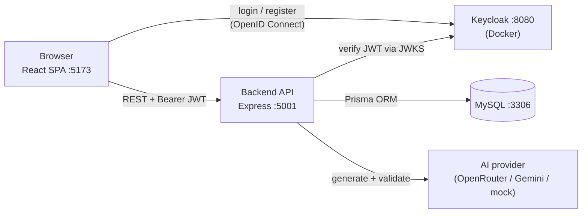
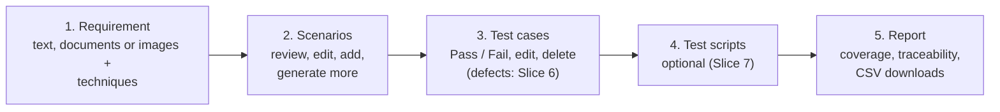

# Architecture

_Last updated: 2026-11-06_

## Overview

The AI Test Case Generator helps testers turn software requirements into test scenarios and test cases with AI, check them, and report on coverage. It's a web app made of three running parts plus a database:



## Tech stack

| Area | Technology |
|---|---|
| Frontend | React 19, TypeScript, Vite 7 (with the React Compiler), Tailwind CSS v4, react-router-dom 7, i18next (English/Thai), keycloak-js |
| Backend | Node.js, Express 5 (ES modules, JavaScript), Prisma 6, jose (JWT verification) |
| Database | MySQL |
| Auth | Keycloak 26 in Docker, with a custom login theme and Google login |
| AI | Provider-agnostic layer: **OpenRouter** (free models now, paid later), Gemini as an optional second provider, plus a mock provider for development and tests |

## Repository layout

```
AI-test-case-generator/
├── frontend/              React SPA
│   └── src/
│       ├── auth/          Keycloak instance, AuthProvider, useAuth()
│       ├── components/
│       │   ├── ui/        Design-system pieces (Button, Card, Badge, Modal, …)
│       │   ├── layout/    AppLayout, TopNav, Sidebar, UserMenu
│       │   └── …          Feature components (dashboard, workspace, project, requirement, coverage)
│       ├── pages/         One file per route
│       ├── services/      API clients; the only place pages get data from
│       ├── mocks/         Temporary fake data behind the services (removed as real APIs arrive)
│       ├── i18n/          i18next setup + en/th dictionaries
│       ├── utils/         Small helpers (class names, formatting, exporters)
│       ├── config.ts      Environment-specific settings (API URL, Keycloak)
│       └── index.css      Tailwind + design tokens (colors, fonts)
├── backend/               Express API
│   ├── routes/            URL → controller mapping (+ auth middleware)
│   ├── controllers/       HTTP layer: parse request, call service, send response
│   ├── dto/               Request-body validation
│   ├── services/          Business logic + database access
│   ├── middleware/        auth.js (JWT verification)
│   ├── ai/                AI pipeline: providers, prompts, checks, orchestrator (see ai-providers.md)
│   ├── scripts/           Developer tools (try-ai.js)
│   ├── config/            keycloak.js (shared Keycloak settings)
│   ├── docs/              openapi.js (Swagger base definition)
│   └── prisma/            schema.prisma, migrations, Prisma client
├── keycloak/themes/       Custom Keycloak login/register theme
├── keycloak/realm/        The app's realm, imported on Keycloak's first start (client, theme, Google login)
├── docker-compose.yml     Runs Keycloak (secrets from the git-ignored root .env, see .env.example)
└── docs/                  This documentation
```

## Authentication flow

1. The frontend starts Keycloak (`check-sso`) before rendering ([frontend/src/main.tsx](../frontend/src/main.tsx)). If the user isn't logged in, the login page redirects to Keycloak. Keycloak handles registration, email/password login and Google login.
2. Every API call sends `Authorization: Bearer <access token>`. The token is refreshed automatically if it expires within 30 seconds ([frontend/src/services/api.ts](../frontend/src/services/api.ts)).
3. The backend checks the token's signature against Keycloak's public keys (JWKS) and the issuer ([backend/middleware/auth.js](../backend/middleware/auth.js)), then puts the token claims on `req.user`.
4. `getOrCreateUser()` links the Keycloak user (`sub`) to a row in our `User` table, creating it on first use.
5. Every project query is scoped to that user, so users only ever see their own data.

## Backend layering

```
routes/*.routes.js → controllers/*.controller.js → dto/* (validation) → services/*.service.js → prisma/client.js
```

Current endpoints (all require login):

| Method | Path | Purpose |
|---|---|---|
| GET | `/api/me` | Get (or create) the current user |
| GET | `/api/projects` | List the user's projects |
| POST | `/api/projects` | Create a project |
| GET | `/api/projects/:id` | Get one project (404 if it isn't the user's) |
| GET | `/api/projects/:projectId/requirements` | List the project's requirements (status, scenario count) |
| POST | `/api/projects/:projectId/requirements` | Create a requirement (gets the next number: REQ-0001, REQ-0002, …) |
| GET | `/api/projects/:projectId/requirements/:number` | One requirement with its scenarios (each with `testCaseCount`), test cases, the run behind the scenarios and every run behind the test cases (`caseRuns`) |
| PATCH | `/api/projects/:projectId/requirements/:number` | Edit title, details, techniques, file names |
| DELETE | `/api/projects/:projectId/requirements/:number` | Move it to Recently deleted for 7 days (with its runs, scenarios and test cases) |
| POST | `/api/projects/:projectId/requirements/:number/technique-suggestions` | AI suggests techniques (saved as a `GenerationRun`) |
| POST | `/api/projects/:projectId/requirements/:number/scenario-drafts` | AI drafts scenarios, saved as a `GenerationRun`. Body `{ mode }`: `replace` (default) replaces the scenarios, `more` adds new ones that don't overlap. `replace` → 409 once test cases exist (D-029) |
| POST | `/api/projects/:projectId/requirements/:number/scenarios` | Add a scenario by hand |
| PATCH | `/api/projects/:projectId/requirements/:number/scenarios/:scenarioNumber` | Edit a scenario (title, description, technique, estimated cases); 409 if it has test cases (D-029) |
| DELETE | `/api/projects/:projectId/requirements/:number/scenarios/:scenarioNumber` | Move a scenario **and its test cases** to Recently deleted for 7 days |
| GET | `/api/projects/:projectId/requirements/:number/scenario-runs` | The last 10 scenario drafts (draft history) |
| POST | `/api/projects/:projectId/requirements/:number/scenario-runs/:runId/restore` | Replace the scenarios with that draft's saved list; 409 once test cases exist |
| POST | `/api/projects/:projectId/requirements/:number/test-case-drafts` | AI writes a shared test-data plan (D-035), then test cases for the scenarios that have none yet, in batches (D-030); returns every batch's run and all test cases. Existing cases are never replaced |
| GET | `/api/projects/:projectId/requirements/:number/test-cases` | The requirement's test cases |
| PATCH | `/api/projects/:projectId/requirements/:number/test-cases/:testCaseNumber` | Set the status (Open / Pass / Fail) or edit title, precondition, steps, expected result |
| DELETE | `/api/projects/:projectId/requirements/:number/test-cases/:testCaseNumber` | Move a test case to Recently deleted for 7 days |
| GET | `/api/projects/:projectId/requirements/:number/defects` | The requirement's defects (Slice 6), in DEF order, with the linked test case number |
| POST | `/api/projects/:projectId/requirements/:number/defects` | Log a defect: title required; severity, priority, status, linked test case, dates and notes optional |
| PATCH | `/api/projects/:projectId/requirements/:number/defects/:defectNumber` | Edit a defect (only the fields sent) |
| DELETE | `/api/projects/:projectId/requirements/:number/defects/:defectNumber` | Move a defect (with its screenshots) to Recently deleted for 7 days |
| POST | `/api/projects/:projectId/requirements/:number/defects/:defectNumber/images` | Attach 1–3 screenshots (multipart `files`; PNG / JPG / WebP by content, ≤ 5 MB, max 3 per defect, D-037) |
| GET | `/api/projects/:projectId/requirements/:number/defects/:defectNumber/images/:imageId` | One screenshot, for its owner only (nosniff, no-store) |
| DELETE | `/api/projects/:projectId/requirements/:number/defects/:defectNumber/images/:imageId` | Remove a screenshot and its file |
| POST | `/api/projects/:projectId/requirements/:number/runs/:runId/reviewed` | "Mark as reviewed" on a scenario or test-case run |
| GET | `/api/history/generations` | History → Generated: finished generations across the user's projects, one item per click (`?kind=`, `?limit=`) |
| GET | `/api/trash` | The user's recently deleted requirements, scenarios, test cases and defects, with days left |
| POST | `/api/trash/:type/:id/restore` | Restore a deleted item (`type` = `requirement`, `scenario`, `testCase` or `defect`) |
| DELETE | `/api/trash/:type/:id` | Delete an item for good now |
| POST | `/api/documents/extract-text` | Read the text of uploaded files (not stored): PDF / DOCX / Markdown / TXT by code; PNG / JPG / WebP images by a vision AI model (D-027). Each image read is logged in `ImageRead` (D-033) |

Requirements are addressed by their **number inside the project**, the same number shown as REQ-0001. Ownership is checked through the project on every request. The AI endpoints always answer `201` with the saved run; an AI problem shows up as `status: "FAILED"` plus `errorMessage` (D-019). They can take a minute or more, so the server allows requests up to 10 minutes. A request that isn't allowed in the current state (e.g. editing a locked scenario) answers **409** with a message.

### API docs (Swagger)

With the backend running, open **http://localhost:5001/api/docs**. The raw OpenAPI spec is at `/api/docs.json`.

- Each endpoint is documented by an `@openapi` comment directly above its route in `backend/routes/*.js`. Shared schemas and security settings are in [backend/docs/openapi.js](../backend/docs/openapi.js). **When you add an endpoint, add its comment in the same change.**
- To call endpoints from Swagger, click **Authorize** and choose one of:
  - **keycloak (OAuth2)**: log in through Keycloak. This needs a one-time Keycloak setting in the admin console (http://localhost:8080 → realm `ai-test-case-generator` → *Clients* → `ai-test-case-frontend` → *Settings*):
    - *Valid redirect URIs*: add `http://localhost:5001/api/docs/oauth2-redirect.html`
    - *Web origins*: add `http://localhost:5001`
    - then click *Save*
  - **bearerAuth**: paste an access token. No Keycloak change is needed.


## Data model

Display codes like `REQ-0001`, `SC-01` and `TC-0001` aren't stored. Each table stores a plain `number`, and the app formats it.

```mermaid
erDiagram
    User ||--o{ Project : owns
    User ||--o| UserPreference : has
    User ||--o{ ImageRead : "image reads (log)"
    Project ||--o{ Requirement : contains
    Requirement ||--o{ GenerationRun : "AI history"
    Requirement ||--o{ Scenario : has
    Requirement ||--o{ TestCase : "numbers TCs"
    Scenario ||--o{ TestCase : has
    Requirement ||--o{ Defect : "numbers DEFs"
    TestCase |o--o{ Defect : "found by (optional)"
    Defect ||--o{ DefectImage : "max 3 screenshots"
    GenerationRun |o--o{ Scenario : produced
    GenerationRun |o--o{ TestCase : produced

    User {
        int id PK
        string keycloakId UK
        string email
        string name
    }
    Project {
        int id PK
        int userId FK
        string name
        text description
    }
    Requirement {
        int id PK
        int projectId FK
        int number "REQ-0001, unique per project"
        string title
        text text
        string sourceFileName
        json techniques "technique keys"
        enum status "DRAFT to REPORTED"
        json testDataPlan "shared test data (D-035)"
    }
    GenerationRun {
        int id PK
        int requirementId FK
        enum kind "TECHNIQUE_SUGGESTION, SCENARIOS, TEST_CASES, TEST_DATA_PLAN"
        enum status "PASSED, NEEDS_REVIEW, FAILED"
        int attempts "1 to 3"
        string generatorModel
        string validatorModel
        json input
        json output "snapshot for restore"
        json validation "checks per attempt"
        json usage "tokens, for credits"
        datetime reviewedAt "Mark as reviewed"
    }
    Scenario {
        int id PK
        int requirementId FK
        int runId FK "null if manual"
        int number "SC-01"
        string title
        text description
        string technique
        int estimatedCases
        enum source "AI or MANUAL"
        datetime deletedAt "set = Recently deleted"
    }
    TestCase {
        int id PK
        int scenarioId FK
        int requirementId FK
        int runId FK "the batch run that wrote it"
        int number "TC-0001"
        string title
        text description
        text precondition
        json steps "string list"
        text expectedResult
        enum source "AI or MANUAL"
        enum status "OPEN, PASS, FAIL"
        bool deletedWithScenario "comes back with its scenario"
        datetime deletedAt "set = Recently deleted"
    }
    Defect {
        int id PK
        int requirementId FK
        int testCaseId FK "optional; cleared if the case is deleted for good"
        int number "DEF-1, never reused"
        string title
        enum severity "CRITICAL, MAJOR, MINOR, TRIVIAL"
        enum priority "HIGH, MEDIUM, LOW"
        enum status "OPEN, IN_PROGRESS, FIXED, CLOSED"
        date openedOn
        date closedOn "set to today when Closed without one"
        text notes
        datetime deletedAt "set = Recently deleted"
    }
    DefectImage {
        int id PK
        int defectId FK
        string fileName "shown only"
        string mimeType "png, jpeg or webp (by content)"
        int size
        string storedName "random name on disk"
    }
    ImageRead {
        int id PK
        int userId FK
        string fileName
        string mimeType
        int size "bytes"
        enum status "PASSED, NEEDS_REVIEW, FAILED"
        int attempts
        string model "the model that answered"
        float seconds
        text text "what was read; null if failed"
        json validation
        json usage "tokens"
        text errorMessage
    }
    UserPreference {
        int id PK
        int userId FK
        json exportColumns
    }
```



**Deleting in the app is a soft delete** (D-024). A requirement, scenario or test case gets a `deletedAt` date, and every normal query skips it. For 7 days it appears in History → Recently deleted and can be restored (children come back with it). After 7 days `purgeExpired()` in `services/trash.service.js` removes it for good; it runs at server start and every hour. `Requirement` also has `deletedAt` (not shown above).

Numbers aren't reused for requirements (a new one takes the highest number + 1, deleted ones included). Scenario numbers are unique among the *active* rows only, checked by the code, not by a database index: a redraft can create a new SC-02 while an old SC-02 waits in the bin, and a restored scenario whose number is taken gets the next free one. New test cases are numbered after the highest number **including deleted ones**, so a test case in the bin always comes back with its own number.

**Scenarios with test cases are locked** (D-029): they can't be edited, and the scenario list can't be redrafted or restored. Deleting such a scenario also deletes its test cases with `deletedWithScenario = true`; restoring the scenario restores exactly those.

At the database level, removing a project removes its requirements, and removing a requirement removes its runs, scenarios and test cases. Removing a run keeps its scenarios (their `runId` becomes empty).

**Image reads are logged, not linked** (D-033). Every AI read of a requirement image, successful or not, is a row in `ImageRead` (who, file, model, time, tokens, the text or the error). The image itself is never stored. Rows aren't linked to a requirement yet, because images are read before the requirement is saved.

**Scenario runs store a snapshot** (D-023). The `output` of every SCENARIOS run is the full scenario list right after that run (for "generate more": existing + new), so any run in the draft history can be restored the same way.

`Requirement.status` controls which steps of the tester flow are unlocked, and follows what the requirement has (`services/requirement-status.js`): no scenarios → `DRAFT`; scenarios → `SCENARIOS_READY` (Step 2); test cases → `CASES_READY` (Steps 3–5). `REPORTED` is reserved for the report (Slice 6).

## Main tester flow (target for Milestone 1)



Status: Steps 1–3 and 5 are built (Slices 3–5). The defect report (under Step 3, and in the report) comes in Slice 6, and test scripts in Slice 7.

Each AI step goes through the same pipeline: **generate → format check → rule checks → AI validation (a different model) → retry up to 3 times**. If it still fails, the result is marked *needs review* for the tester to fix by hand. Every generation is stored as a `GenerationRun`: scenario drafts can be restored (any of the last 10, until test cases exist), and every finished generation is listed in History → Generated. Test cases are generated in batches of at most 8 estimated cases, two at a time, one run per batch (D-030). Before the batches, one short call writes the test-data plan they all share (D-035).

## AI module (`backend/ai/`)

A self-contained module. The rest of the backend imports only `backend/ai/index.js`:

| Function | Used in | Returns |
|---|---|---|
| `suggestTechniques({ requirementText })` | Step 1 "Let AI suggest" | Suggested techniques with reasons |
| `draftScenarios({ requirementText, techniques })` | Step 1 → 2 | Scenarios (title, description, technique, estimated case count) |
| `planTestData({ requirementText, scenarios, existingPlan })` | Step 2 → 3, before the batches | The shared test-data plan: conventions + records (D-035) |
| `generateTestCases({ requirementText, techniques, scenarios, testDataPlan })` | Step 2 → 3 (called once per batch) | Test cases linked to scenarios |
| `readRequirementImage({ fileName, mimeType, base64 })` | Step 1 image upload | The image's text, for the editable details (D-027) |

Each returns an object shaped like a `GenerationRun` row: status, attempts, output, per-attempt check results, token usage and model names. Providers are swappable per role: OpenRouter (main, free models now), Gemini (images first; optional for text), a mock for tests and offline work, and OpenAI/Claude can be added. Full details, setup and the switching guide: [ai-providers.md](ai-providers.md).

## Frontend structure

- **Routing** ([frontend/src/App.tsx](../frontend/src/App.tsx)): `/` Dashboard, `/workspace` Projects, `/projects/:projectId`, `/projects/:projectId/requirements/new` and `/projects/:projectId/requirements/:requirementNumber` (the requirement page, step in `?step=`), `/history` (Generated + Recently deleted), `/account` (coming soon). All pages share `AppLayout` (top nav + sidebar).
- **Data access:** pages only call functions in `src/services/`, which use one `request()` helper ([services/http.ts](../frontend/src/services/http.ts)). It adds the login token, sends JSON or files, and turns error answers into an `ApiError` carrying the backend's own message. Projects and requirements use the real API. Only the Dashboard still reads `src/mocks/dashboard.ts` (until M2).
- **Requirement page** ([pages/RequirementPage.tsx](../frontend/src/pages/RequirementPage.tsx)): one page with the 5 steps (01 Requirement · 02 Scenarios · 03 Test cases · 04 Test scripts · 05 Report). A step unlocks when the requirement's status reaches it (see `components/requirement/steps.ts`).
  - Step 1 (`RequirementStep`): three numbered cards: describe, attach files or images (`SpecificationFiles`), choose techniques (`TechniquePicker`). Once test cases exist, its main button opens Step 2 instead of redrafting.
  - Step 2 (`ScenariosStep`): a toolbar (Add scenario, Generate more, Redraft, History, Generate N test cases / View test cases), `ScenarioCard`s (a 🔒 tag and no Edit when locked), `ScenarioForm`, the draft history (`ScenarioHistory`), the out-of-date panel (`CaseSyncPanel`) and the review note / AI notes (`ReviewNote`).
  - Step 3 (`TestCasesStep`): the table grouped by scenario with status checkbox + dropdown, the ⋯ menu (`ui/ActionMenu`) with Edit (`TestCaseForm`) and Delete, the out-of-date banner and the notes of every batch run.
  - Step 4: a placeholder (`StepPlaceholder`) with Skip to report. Step 5 (`ReportStep`): the coverage card (`coverage/CoverageReport`) and the CSV downloads (`utils/testCaseExport.ts`, `utils/download.ts`).
- **History page** ([pages/HistoryPage.tsx](../frontend/src/pages/HistoryPage.tsx)): "Generated" (`components/history/GeneratedList`: filters, one entry per click, Open) and "Recently deleted" (`components/history/DeletedItemList`) with Restore / Delete forever and the days left.
- **Design system:** colors and fonts are Tailwind tokens in [frontend/src/index.css](../frontend/src/index.css) (`ink`, `brand`, `success`, `warning`, `danger`; Space Grotesk / IBM Plex Sans / IBM Plex Sans Thai / IBM Plex Mono). The shared pieces live in `components/ui/`.
- **Languages:** every UI string comes from `i18n/locales/en.ts` and `th.ts`. The chosen language is remembered in the browser.

## Configuration

Settings come from environment variables, with local-development defaults. See `frontend/.env.example`, `backend/.env.example` and the root `.env.example` (Keycloak).

| Variable | Where | Purpose |
|---|---|---|
| `VITE_API_URL` | frontend | Backend base URL |
| `VITE_KEYCLOAK_URL`, `VITE_KEYCLOAK_REALM`, `VITE_KEYCLOAK_CLIENT_ID` | frontend | Keycloak connection |
| `DATABASE_URL` | backend | MySQL connection string |
| `PORT` | backend | API port (default 5001) |
| `KEYCLOAK_URL`, `KEYCLOAK_REALM` | backend | Used to verify tokens (and by Swagger) |
| `KEYCLOAK_CLIENT_ID` | backend | Client used by Swagger's "Authorize" (default `ai-test-case-frontend`) |
| `GOOGLE_CLIENT_SECRET` | root `.env` (Docker) | Google login secret, filled into the imported Keycloak realm |
| `OPENROUTER_API_KEY`, `OPENROUTER_*_MODEL`, `GEMINI_API_KEY`, `GEMINI_*_MODEL`, `GEMINI_*_FALLBACK_MODEL`, `AI_REQUEST_TIMEOUT_SECONDS`, `AI_GENERATOR_PROVIDER`, `AI_VALIDATOR_PROVIDER`, `AI_VISION_PROVIDER`, `AI_DEBUG`, `MOCK_FAIL_MODE` | backend | AI settings; see [ai-providers.md](ai-providers.md#3-setting-up-openrouter-main-provider) |

## Uploaded files (D-037)

Defect screenshots are the only files the app keeps (requirement documents and images are read and thrown away). They live on disk under `UPLOAD_DIR/defects/<defectId>/<random>.png|jpg|webp` (default `backend/uploads`, git-ignored) and are served only through the logged-in image endpoint. `services/defect-image-store.js` checks the type by content, names the files, and sweeps files whose defect is gone (after "Delete forever" and in the hourly purge). If the backend runs in Docker, mount `UPLOAD_DIR` as a volume.
